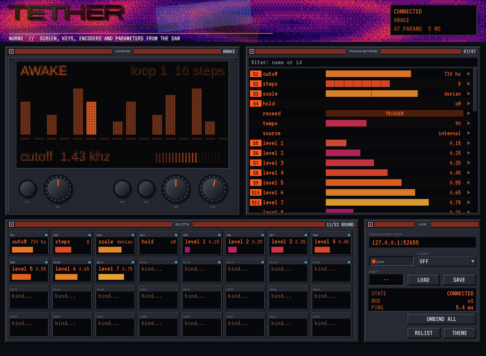

# TETHER

**norns, DAW'ın içinden: ekran, tuşlar, enkoderler, parametreler ve otomasyon.**
AU / VST3 / Standalone · JUCE 8 · macOS, Linux (Windows derlenir, denenmedi) · norns tarafında bir mod



norns'un sesi kendi kutusundan çıkar; TETHER onu DAW'dan çalmanın yolu. Eklenti norns'un ekranını
canlı gösterir, K1–K3'e basar, E1–E3'ü çevirir, çalışan script'in bütün parametrelerini listeler ve
otuz iki host parametresini (**SLOT 1–32**) istediğin norns parametresine bağlar: DAW o slotları
otomasyonla sürer, CONDUIT onlara patch'ler. Ters yönde norns'un kendi tuşları ve enkoderleri aile
otobüsüne çıkar: norns, bütün ailenin elle tutulur controller'ı olur.

İki parça var:

| parça | nerede | ne yapar |
|---|---|---|
| **TETHER** eklentisi | DAW | panel, parametre listesi, slotlar, aile bağlantısı |
| **tether** mod'u | norns, `~/dust/code/tether/lib/mod.lua` | parametre listesini ve değişimleri, ekranı, donanım tuşlarını eklentiye yollar; eklentiden gelen yazmaları uygular |

Mod gerekli, çünkü norns OSC ile komut alır ama kendiliğinden geri bilgi vermez (parametre listesi,
ekran, tuşlar). Mod olduğu için her script'in altında çalışır; bir kere kurulur. Mod yokken bile
tuşlar ve enkoderler gider (norns'un çekirdeğindeki `/remote/key`, `/remote/enc`).

---

## İçindekiler

1. [Kurulum](#1-kurulum)
2. [Panel](#2-panel)
3. [Parametreler](#3-parametreler)
4. [Slotlar](#4-slotlar)
5. [LINK: bağlantı, saat, PSET](#5-link-bağlantı-saat-pset)
6. [Aile](#6-aile)
7. [Sınırlar](#7-sınırlar)
8. [Derleme](#8-derleme)
9. [Testler](#9-testler)
10. [Dosyalar](#10-dosyalar)

---

## 1. Kurulum

**norns:**

```sh
scripts/dev.sh mod                  # ya da: scripts/dev.sh mod 192.168.1.20
```

Elle: `norns/tether/lib/mod.lua` dosyasını norns'ta `~/dust/code/tether/lib/mod.lua` yoluna koy
(Maiden'da `code/` altına `tether/lib/` klasörü açıp yapıştırmak da olur). Sonra norns'ta
**SYSTEM > MODS**, `TETHER`'ı seç, **E3** ile aç (`+`), **SYSTEM > RESTART**.

**DAW:**

```sh
scripts/dev.sh setup && scripts/dev.sh build && scripts/dev.sh install
```

TETHER'ı bir instrument kanalına koy. Varsayılan adres `norns.local`; bulamazsa norns'un IP'sini
(norns'ta **SYSTEM > WIFI**) LINK penceresindeki alana yaz. Bilgisayar ile norns aynı ağda olmalı.

**SYSTEM > MODS**'ta TETHER'ın üstünde K3 mod'un sayfasını açar: bağlı eklentiler kanal adlarıyla
görünür; orada K3 hepsini düşürür (eklentiler bir saniye içinde yeniden bağlanır), K2 geri.

## 2. Panel

| | |
|---|---|
| **ekran** | norns'un ekranı, 128 × 64, 16 parlaklık, temanın mürekkebiyle, 30 fps. Yalnız editör açıkken akar |
| **K1–K3** | tıkla ve tut: norns'taki gibi basılı kalır |
| **E1–E3** | yukarı / aşağı sürükle ya da tekerlek; shift ile ince |
| **klavye** | panele bir kez tıkla: **1 2 3** tuşlar, **Q/A W/S E/D** enkoderler (shift: tek adım) |
| **parlama** | norns'taki gerçek tuş ve enkoder hareketleri panelde yanar, başlık plazması tepki verir |

Bağlantı yokken ekran durumu söyler: `LOOKING UP`, `NOT FOUND` (ad çözülmedi), `WAITING`,
`NO REPLY` (cevap yok: mod açık mı?), `LOST` (sessizleşti; ağ değiştiyse adı yeniden çözer).

## 3. Parametreler

Çalışan script'in parametreleri, mod'un listelediği sırayla. Script değişince liste kendiliğinden
yenilenir.

- **çubuğu sürükle**: değeri norns'ta ayarla. Kademeli parametreler (number, option) adımlara oturur,
  binary tıklayınca döner, trigger tıklayınca tetiklenir.
- **ctrl/alt + tekerlek**: imlecin altındaki parametreyi tek adım.
- **sağ tık** (ya da satırın başındaki rozet / sondaki ok): **bind to** ile bir slota bağla.
- **filtre**: ada ya da id'ye göre.

Değerler norns'un kendisinden gelir: script, norns menüsü ya da başka bir eklenti değiştirse de
liste günceldir. Bir slota bağlı parametreyi sürüklemek **slotu** hareket ettirir: host bunu görür
ve kaydeder, otomasyon ile panel birbiriyle kavga etmez.

## 4. Slotlar

Otuz iki host parametresi: `SLOT 1` … `SLOT 32`. Bir slot bir norns parametresine bağlanınca hostta
adı onu söyler (`S1 cutoff`), böylece otomasyon şeridi neyi sürdüğünü gösterir.

- **bağlamak**: slotun adına tıkla, listeden seç (uzun listeler 30'arlık sayfalarda); ya da parametre
  listesinde sağ tık. Bir parametre tek bir slota bağlanır.
- **bağlanınca** slot o anki norns değerine atlar: hiçbir şey zıplamaz.
- **değer** = slotun kendi değeri + CONDUIT'in ofseti; çubuk dışarı gideni gösterir, CONDUIT
  bağlıyken `CV` rozeti ve slotun kendi konumu ayrı çizgi.
- slotlar **1–16** aile otobüsünde giriş (köşedeki mavi nokta), **17–32** yalnız host.
- slotlar yalnız **DAW → norns** yönündedir: norns'ta aynı parametreyi elle çevirirsen slot onu
  izlemez, slot bir sonraki hareketinde kendi değerini yazar.
- bağlantılar oturumla kaydedilir; script değişip parametre kaybolursa slot bağlı kalır (değer
  `--`), o script geri gelince yine çalışır.

## 5. LINK: bağlantı, saat, PSET

| | |
|---|---|
| **NORNS** | `norns.local`, bir IP, ya da `host:port` |
| **LINK** | kapalıyken hiçbir şey gitmez (mod'a `bye` der) |
| **CLOCK** | `OFF` · `TEMPO`: hostun temposu norns'a · `TEMPO + PLAY`: ayrıca başlat / durdur. Yalnız norns'un saat kaynağı `internal` iken uygulanır. Faz kilidi için ikisinde de **Ableton Link** daha sıkıdır; TETHER'ın saati OSC üzerinden tempo ve transport taşır |
| **PSET** | bir numara seçmek norns'ta o preset'i yükler (`--` dokunmaz). Aynı numara yeniden yüklemez; **LOAD** zorla yükler. Oturum açılırken PSET kendiliğinden yüklenmez |
| **SAVE** | norns'un şimdiki halini PSET numarasına yazar (`--` ise 01) |
| **RELIST** | parametre listesini yeniden iste |
| **UNBIND ALL** | bütün slotları boşalt (değerleri kalır) |
| **THEME** | ailenin on üç teması |

## 6. Aile

`family.json` ile aileye katılır (`family-sdk` 1.0.2, `kind: TETHER`).

| port | yön | ne |
|---|---|---|
| `K1` `K2` `K3` | çıkış, olay `TRIG` (a = tuş) | norns'taki tuşa basıldı |
| `E1` `E2` `E3` | çıkış, değer | norns enkoderleri birer düğme gibi: 0..1, ortadan başlar, 96 adımda uçtan uca |
| `SCRIPT` | çıkış, olay `DATA` (u = adın hash'i) | norns'ta başka bir script yüklendi |
| `SLOT1` … `SLOT16` | giriş, mod | CONDUIT'in ofseti slota eklenir, norns parametresine gider |
| `PRESS1` `PRESS2` `PRESS3` | giriş, tetik | norns'ta o tuşa bas ve bırak |

Örnekler: LOOPGENOME'un `KICK`'i → TETHER `PRESS3` (norns script'i her kick'te K3); EPOCH `ENERGY`
→ TETHER `SLOT1` (bir filtre); norns'un `E1`'i → SEEDWALK `LEVEL` (norns'un enkoderi SEEDWALK'ı
sürer); TETHER `K2` → SPLICEBUS `SPLICE`.

**SETBOOK** bütün slotları ve PSET'i yakalar: slotlar `GLIDE` ile süzülür, PSET `JUMP` ile atlar
(bir sahne norns'un preset'ini de çağırır). `LINK` ve `CLOCK` sahne dışıdır. **BLACKBOX** her slot
ve PSET değişimini kaydeder.

## 7. Sınırlar

- **Ses taşımaz.** norns'un sesini DAW'a almak için ses arayüzü üzerinden kaydet.
- **Ağ gecikmesi**: Wi-Fi'de genelde 2–20 ms, oynaktır. Otomasyon ve sahne için yeterli, örnek-doğruluğu
  yok; sıkı ritmik tetik için norns'un MIDI'ı ya da Link daha iyidir.
- **Ekran aynası** 30 fps'te en çok ~240 KB/s (yalnız değişen bantlar gider, genelde çok daha az);
  editör kapanınca durur.
- Slot değerleri en çok ~120 Hz, değişim eşiği 0.0001.
- Parametre tipleri: number, option, control, taper, binary, trigger. Dosya ve metin parametreleri
  listelenmez.
- Slotlar tek yönlü (bkz. §4).

## 8. Derleme

```sh
scripts/dev.sh setup            # yapılandır (ccache, LTO kapalı)
scripts/dev.sh build            # VST3 / AU / Standalone + testler
scripts/dev.sh test             # motor + mod + işlemci testleri
scripts/dev.sh shots            # editör ekran görüntüleri (sahte norns'a karşı)
scripts/dev.sh install          # ~/Library/Audio/Plug-Ins, auval
scripts/dev.sh mod [host]       # mod'u norns'a kopyala (ssh we@norns.local, şifre: sleep)
scripts/dev.sh release          # LTO ile temiz derleme
```

JUCE yerelde değilse 8.0.10 indirilir (`JUCE_DIR=~/dev/JUCE scripts/dev.sh setup` yerelini kullanır).
family-sdk aynı şekilde; yerel kopya için `-DFETCHCONTENT_SOURCE_DIR_FAMILY_SDK=~/dev/family-sdk`.
Mod testleri için Lua 5.3 ya da 5.4 (`brew install lua`); yoksa o testler atlanır.

## 9. Testler

| test | ne |
|---|---|
| `mod` | `tests/mod_test.lua`: mod sahte bir norns üstünde. hello / welcome, satır satır liste, her tipin yazılması, norns tarafı değişimler, tuş / enkoder enjeksiyonu (geri yankı yok), donanım raporu, diğer OSC'nin geçmesi, ekran bantları ve iyileşme, saat (yalnız internal), PSET, ping, script değişimi, istemcinin düşmesi |
| `engine` | `tests/EngineTests.cpp`: OSC kodlayıcı (bundle, double, blob, bozuk paket); sonra **gerçek mod**, `tests/norns_sim.lua` içinde, **gerçek UDP** üstünden eklentinin bağlantısıyla uçtan uca: liste, yazma ve yankı, slotlar (bağlarken zıplamama), tuşlar, donanım olayları, ekran (kapanınca durma), tempo, PSET, script değişimi, kayıp satırların iyileşmesi, sessizleşip geri gelme, LINK kapalı; cevap vermeyen adres (`NO REPLY`, `/remote/key`), çözülmeyen ad |
| `processor` | `tests/ProcessorTests.cpp`: eklenti aynı sahte norns'a karşı: manifest, otobüs, portlar; slot bağlama, host adları, otomasyon norns'a; CONDUIT ofseti `SLOT1`'e, `PRESS2` tetiği; norns donanımı aileye (`K3` olayı, `E2` değeri); `SCRIPT` olayı; PSET; saat; state; ikinci örnek; editör (ilk kare, liste, 13 tema); LINK kapalı |

Sahte norns gerçek `mod.lua`'yı çalıştırır: iki taraf da gönderilen koddur, protokol ayrı ayrı
taklit edilmez. Gerçek norns'a karşı denenmedi (bkz. aşağıdaki not).

## 10. Dosyalar

```
norns/tether/lib/mod.lua        norns mod'u (Lua)
Source/engine/Osc.h             OSC kodlayıcı / çözücü (JUCE'suz)
Source/engine/Udp.h             UDP soket, ad çözme (norns.local)
Source/engine/NornsLink.*       bağlantı thread'i: hello / ping, liste, slotlar, ekran, saat
Source/PluginProcessor.*        slotlar, PSET, aile bağlantısı
Source/PluginEditor.*           pencereler, slot hücreleri, LINK
Source/ui/NornsPanel.*          ekran aynası, tuşlar, enkoderler
Source/ui/ParamList.*           parametre listesi
Source/ui/{Themes,Look,Header,Widgets,Ink}.h   ailenin görünümü (CONDUIT'ten)
family.json                     aile manifesti
docs/PROTOCOL.md                OSC protokolü
tests/                          mod testi, sahte norns, motor ve işlemci testleri
tools/Snapshot.cpp              ekran görüntüleri
```

> **Not:** Mod, norns'un `core/mods`, `_norns.osc.event`, `_norns.key/enc`, `screen.peek`,
> `metro` ve `clock.internal` API'lerine dayanır (norns 2.7+). Gerçek bir norns'ta ilk denemede
> mod menüsünü, ekran aynasını ve tempo senkronunu kontrol et; sorun çıkarsa norns'ta
> `sudo journalctl -u norns-matron -f` hatayı gösterir (mod hatalarını `tether:` önekiyle yazar).
